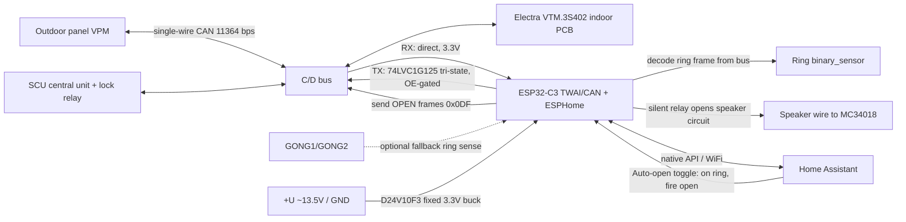

# Electra Smart+ to Home Assistant (ESP32 + ESPHome)

## Goal

Native HA integration of the `VTM.3S402.ELB04` indoor unit, by interfacing at the unit's own signals (simulating its touch / replaying its own bus command), without re-architecting the building system:

- `binary_sensor` - fires on ring (from the CAN ring frame; the GONG relay is now only a fallback)
- `button` - opens the door
- `switch` (Silent) - while on, the unit's speaker is cut by a relay during the ring only
- `switch` (Auto-open) - while on, the door opens automatically on ring (configurable delay, default 0)
- RGB status LED - one addressable pixel whose color shows the combined toggle state at a glance (off = none active)

Target board: **ESP32-C3** (compact, 3.3V, enough GPIO, runs ESPHome). Custom PCB after validation.

## Why this works (grounded in the resources)

- The manual ([docs/Terminals_USM_XTM(E)02_ELY04_EN_16_11_2017.pdf](docs/Terminals_USM_XTM(E)02_ELY04_EN_16_11_2017.pdf)) confirms a 4-wire residential system with terminals `+U / C/D / GND / Vin / Vout` plus doorbell `DBL1/DBL2` and gong relay `GONG1/GONG2`.
- The GitHub repo's `intercom-device.h` proves the general method: detect ring, and trigger open by reproducing what a button press does. Our unit's manual allows a standby long-press (2-3s) of the key to open directly - the simplest open trigger to reproduce.
- Your system is closed-loop on your own property, so modifying your own unit is fine.

## Board findings (confirmed from teardown photos, Jun 20)

Photos: [docs/pcb-full-board.jpg](docs/pcb-full-board.jpg) (full board) and close-ups `pcb-audio-mc34018.jpg`, `pcb-analog-switch-hef4066.jpg`, `pcb-video-decoder-tw9900.jpg`, `pcb-ldo-ld1117.jpg`, `pcb-mcu-pic18f25k80-icsp.jpg`.

- Board: `ELECTRA PCB.3S40.VTMR-REV2` (Feb 2019) - matches the unit.
- **Main MCU: Microchip `PIC18F25K80`** (8-bit PIC) with a populated **ICSP** header beside it. It senses the touch pads, drives the LEDs, and speaks the `C/D` bus. There is **no separate touch-controller IC** - so there is no discrete per-button line to pull (the repo's exact trick does not apply).
- **Logic rail ~3.3V** (regulator is an `LD1117` LDO). => ESP32-C3 can interface the MCU/bus lines directly, **no level shifter needed** (confirm with meter).
- **Audio block:** `UTC MC34018` speakerphone IC (`IC1`) + `HEF4066BT` quad analog switch (`IC6`) + `NJM4580` op-amp, with `MIC+/MIC-` pads and the **red/black speaker wire** - the Silent intercept point.
- **Video:** Techwell `TW9900` decoder + 27 MHz crystal - camera path, not relevant.
- **Terminal block:** `+U / C/D / GND / Vin` (Line IN), `+U / C/D / GND / Vout` (Line OUT), `DBL1 / DBL2 / GONG1 / GONG2`.

## PROTOCOL SOLVED: C/D is a single-wire CAN bus (Aug 10)

Full detail in [docs/reverse-engineering.md](docs/reverse-engineering.md). Summary:

- The `C/D` line is **CAN**, confirmed by Electra's own Touch Line catalogue ("Green LED (C/D) for working CAN BUS system", "4 CAN outputs for 4 video/audio terminals"), by the PIC18F25K80's integrated **ECAN** peripheral, and decisively by Saleae's CAN decoder producing **valid CRCs and ACK=true** on our capture.
- Single-wire, 3.3 V logic, recessive = HIGH / dominant = pulled LOW. **~11,363.6 bps** (`16 MHz / (2 x 44 x 16)`). Standard 11-bit IDs.
- **Frame catalogue** (every frame independently **CRC-15 verified** by `tools/can_decode.py` - **18/18 match** across the Open, Ring and Call/Answer captures, which also proves the IDs are right since CRC covers the ID field):


| Event                            | CAN ID  | DLC | Data                                     |
| -------------------------------- | ------- | --- | ---------------------------------------- |
| Open (standby long-press)        | `0x0DF` | 4   | `02 07 01 00`                            |
| " (+25.7 ms)                     | `0x0DF` | 3   | `01 01 07`                               |
| " (+43.9 ms)                     | `0x000` | 2   | `00 02`                                  |
| " then                           | -       | -   | line dominant ~8.9-9.0 s = audio session |
| **Ring / call start**            | `0x0DF` | 4   | `04 03 01 00`                            |
| " (+16.2 ms)                     | `0x001` | 3   | `01 01 03`                               |
| **Call end** (timeout, +59.70 s) | `0x0DF` | 2   | `04 04`                                  |
| " (+35.8 ms)                     | `0x000` | 3   | `01 01 04`                               |
| **Answer / Talk**                | `0x001` | 4   | `01 05 DF 00`                            |
| " (same burst)                   | `0x0DF` | 3   | `04 01 05`                               |


- **Addressing solved:** this unit is **labelled 223 = `0xDF`** (the panel must be given 223 to call it), so `0x0DF` is **the terminal's own address**, not a broadcast ID - and the `DF` byte inside the answer frame is the same address. Field model that fits all nine frames: **CAN ID = per-device channel** (`0x0DF` us, `0x001` panel/apartment 1, `0x000` system), **byte 0 = originator class** (`04` panel/SCU, `01`-`02` terminal), **byte 1 = command code**, **byte 2 = the other party's address**. Consequence: **the address must be a configurable substitution in the firmware, not a hardcoded constant**, so the same build works on a unit left at the factory default (`0x001`) - e.g. the friend's unit.
- Event codes (byte 1 of the DLC-4 announcement): `03` call start, `04` call end, `05` answer/Talk, `07` open. `0x000` / `00 02` is an **"engage audio"** command - the line goes dominant within ~7 ms of it every time.
- **The `C/D` line also carries the call audio**, held dominant for 1.8 s while talking and ~8.9 s after an open, and no CAN traffic is possible during it. Almost certainly analog voice superimposed, since 11.4 kbps cannot carry speech. **Our node must never drive the line during a call** - hence listen-only mode plus a tri-state TX gate below.
- Full addressing semantics are unresolved and not needed; the frames we must recognise and the one we must send are known.
- Ring involves **no audio hold**, and we get an explicit **call-end** frame - so the HA ring sensor can be exact rather than timeout-based, and auto-open can transmit freely during a ring.
- No one has published this before (the 2023 Nuki thread for the sibling model is still unanswered; the only public Electra repos - `adrian-dobre/Nano33IoT-Electra-Intercom`, `kind3r/electra-esp32-analog`, `EmanuelBalaban/intercom` - are all **analog** models with discrete button lines).

## Open-trigger strategy (RESOLVED: native CAN, not waveform replay)

The ESP32-C3 has a built-in **TWAI** CAN peripheral, so we speak CAN properly instead of bit-banging a captured waveform:

- Hardware framing, CRC, ACK, **arbitration** and error handling - a CAN controller cannot "jam" the bus the way a blind replay could, which retires the earlier "which burst was ours?" risk entirely.
- We also **receive** everything, so **ring detection comes from the bus itself** - the GONG tap drops to an optional fallback (and the flaky CH2 lead becomes moot).
- Full state awareness even when the intercom is operated by hand (door opened, call active, mute toggled).
- Both older paths are now dead: Path A (touch injection) unnecessary, Path B (raw waveform replay) superseded.

**Bit-rate feasibility:** `80 MHz / 11363.6 = 7040` time quanta; at 16 TQ/bit -> `brp = 440`, giving `80e6 / (440 x 16) = 11363.6 bps` **exactly**, within the C3's `brp` range. Caveat: ESPHome's `esp32_can` may only expose preset bit rates, so expect to need a custom timing config or a small custom component.

**Interface hardware (simpler than the old MOSFET plan):**

- **RX:** `C/D` -> series resistor -> TWAI RX GPIO (already 3.3 V, direct)
- **TX:** TWAI TX -> **74LVC1G125** (single-gate *tri-state* buffer) -> `C/D`, with `OE` on its own GPIO. TX low pulls the bus dominant; TX high or `OE` deasserted leaves it recessive. A `74LVC1G07` open-drain buffer works electrically too, but the tri-state version lets us guarantee the ESP32 **cannot** drive `C/D` during a call (see the audio constraint above). Either way: no MOSFET, no inverter, no level shifting, and *not* a differential CAN transceiver (TJA1051 / SN65HVD230 would be wrong - this bus is single-wire, not CANH/CANL).
- **Operating mode: listen-only by default.** Run TWAI in `TWAI_MODE_LISTEN_ONLY`, switching to normal mode only for the instant we transmit, and only while the line is recessive. In listen-only the controller never drives the line - no ACKs, no error flags - which matters because a multi-second dominant audio hold looks like a stuff error to a CAN controller, and in normal mode it would answer with active (dominant) error flags until its receive error counter passes 127.

## Architecture / signal flow




## Bill of materials

- ESP32-C3 board (C3 SuperMini HW-466AB) - small footprint for embedding; avoid strapping pins (GPIO2/8/9) and USB pins (GPIO18/19). WiFi/OTA is a non-issue here (router ~4m, line of sight)
- Status LED: one addressable RGB pixel (WS2812 / SK6812) - single data GPIO, encodes all toggle states by color; later coupled to an **end-glow (end-emitting) PMMA fiber, ~2 mm** (1.5 mm subtle / 3 mm bold) to surface a dot on the case face. Keep fiber core <= pixel emitter; shroud the LED-to-fiber junction with opaque heat-shrink; flat-polish both ends; drill faceplate to fiber OD. (~330 ohm inline on data, optional small decoupling cap)
- **Pololu D24V10F3** fixed-3.3V 1A buck - powers the board from the unit's `+U` (~13.5V) line, straight into the SuperMini's `3V3` pin. Fixed output removes the mis-set-trimpot hazard, and bypassing the onboard LDO takes end-to-end efficiency from ~57% to ~87%. **No 5V rail exists**, so the relay coil is the 12V version run off raw `+U`. Never connect USB and `+U` at the same time.
- Logic analyzer (have it) - used to solve the bus; all planned captures are now complete, keep it only for debugging the bench node
- **CAN interface: `74LVC1G125` single-gate tri-state buffer** (SOT-353/SC-70) - the TX driver onto `C/D`, with `OE` on a GPIO so we can hard-disable driving during a call. (`74LVC1G07` open-drain is the simpler alternative if we skip the OE gate.) Plus ~1k series resistor on RX and optional small clamp diodes. **Do NOT use a differential CAN transceiver** (TJA1051 / SN65HVD230) - this bus is single-wire, not CANH/CANL.
- Level shifter NOT needed (bus and MCU are both 3.3V)
- 1x optocoupler (e.g. PC817) + resistors - now only an *optional* fallback ring sense off GONG (primary ring detection is from the CAN bus)
- Silent toggle: **Omron G6K-2F-Y DC12** - subminiature DPDT signal relay, gold-clad bifurcated contacts (ideal for low-level audio), 10x6.5x5.2 mm, ~100 mW coil, contacts 1 A switching / 2 A carry. Already SMD: Omron's `F` field = outside-L gullwing surface-mount terminals (`P` would be through-hole). Use one pole's **NC** contact (second pole = free spare). Drive the low side via NPN/FET (MMBT2222 + ~1k base R, or logic-level FET) + flyback diode (1N4148W). Run the coil off **raw `+U`** rather than the regulated rail: there is no 5 V rail in the single-3.3V-rail design, and this way the coil costs no conversion loss and keeps its switching step off the MCU supply. Coil is 1315 ohm / 9.1 mA / 100 mW at 12 V, so add **150 R in series** - straight off 13.5 V it would run at 139% of rated coil power, and the datasheet's 150% figure is instantaneous, not continuous. Wire as a **no-cut inline adapter** at `J101`: take a ready-made **2-pin male-to-female extension cable** (1.25 mm "JST 1.25" most likely; buy 1.0 mm SH as well and go by fit), cut it in half, pass one conductor straight through and break the other with COM->NC. Fail-safe: de-energised = speaker connected, so the intercom rings normally if our board is unpowered, and the coil is energised only during a silenced ring.
- Multimeter, fine-tip soldering iron, thin silicone wire, dupont jumpers, breadboard
- Heat-shrink / kapton tape for the permanent install

## Phase 1 - Signal capture + protocol decode (MOSTLY DONE)

Done: board/silicon ID, DC survey, `C/D` idle behaviour, the Open capture, and **full protocol identification (single-wire CAN @ ~11,364 bps) with the Open frames decoded**. See [docs/reverse-engineering.md](docs/reverse-engineering.md).

Remaining captures (all passive, zero risk - unit is on the bench):


| #   | Capture                         | Purpose                                                                                      | Status                                                                                                        |
| --- | ------------------------------- | -------------------------------------------------------------------------------------------- | ------------------------------------------------------------------------------------------------------------- |
| C11 | Ring                            | Ring frame for the HA sensor + sender attribution                                            | **DONE** - call start `04 03 01 00`, call end `04 04`, 59.70 s window                                         |
| C12 | Call -> answer -> open          | Frames for answer/talk, and open-during-call                                                 | **DONE** - answer `0x001` `01 05 DF 00`; open frames identical to standby; found the audio-session constraint |
| C13 | Volume / Monitor / AUX / Mute   | Frame set for the remaining features, incl. the built-in **MUTE** as a cleaner Silent option | **DONE** - monitoring = `02 08 00` (+ video-enable `0C`); **AUX and MUTE emit nothing at all** |


Then, with the frame table complete, the decision gate is already passed:

- [x] Join the bus as a native CAN node (ESP32-C3 TWAI) - **chosen**
- [ ] ~~Path B raw waveform replay~~ - superseded
- [ ] ~~Path A touch injection~~ - not needed

Risk + fallbacks:

- Ring: primary = decode the ring frame off CAN. Fallback = `GONG1/GONG2` dry contact into a C3 input (pull-up, opto-isolate if not clean).
- Open: CAN arbitration makes transmission inherently safe. If the two `0x0DF` frames alone do not open, try sending only frame 1, or the full three - empirically safe on a private system.
- Silent: **relay confirmed as the only option.** C13 showed the unit's own MUTE emits nothing on the bus, so there is no frame to send and no way to observe its state. Use the signal relay on the speaker leg via a no-cut inline adapter on the NC contact (fail-safe: speaker works if our board is unpowered). Upside: firmware can open the contact *only during the ring window* and restore it on answer, so a silenced call is still audible if you pick up - better behaviour than the native MUTE.

## Phase 2 - Bench prototype

1. Flash the ESP32-C3 on USB alone first (everything after is OTA). Then verify `+U` polarity, check the D24V10F3 puts out 3.3V unloaded, unplug USB, and wire it into the SuperMini's `3V3` pin.
2. Wire the CAN interface: `C/D` -> series R -> TWAI **RX** GPIO; TWAI **TX** GPIO -> `74LVC1G125` (`OE` on a GPIO) -> `C/D`. Common `GND` with the unit. Silent relay on its own GPIO.
3. **Listen-only first, with TX hard-disabled:** bring up TWAI in listen-only at 11363.6 bps, `OE` deasserted, and confirm ESPHome logs the exact same frames the logic analyzer saw (ring `04 03 01 00`, call end `04 04`, open `02 07 01 00`) with no error counters climbing. This validates bit timing with zero risk to the bus.
4. Confirm the node survives a **call audio session** (the multi-second dominant hold) without flagging errors or driving the line.
5. Then transmit: enable `OE`, send `0x0DF` / `02 07 01 00` while the line is idle, and confirm the door opens. If it does not, try adding the `01 01 07` and `00 02` follow-ups. Verify the intercom itself still behaves normally (panel still calls, audio still clean).
6. Verify Silent: energize the relay, have the panel call, and confirm the **ring melody** is actually silenced - not just conversation audio. This also settles whether the ring and the voice share one emitter, or whether there is a separate buzzer that the speaker leg does not carry.
7. Verify the release path: with Silent armed, answer a silenced call and confirm the speaker comes back so the conversation is audible.

## Phase 3 - ESPHome firmware (WRITTEN AND COMPILING)

Delivered:

- `esphome/components/electra_can/` - custom canbus platform: arbitrary bit rate solved into TWAI
  registers at validation time, listen-only by default, runtime swap to normal mode to transmit only
  once the line has been quiet. See [esphome/README.md](esphome/README.md).
- `esphome/electra-intercom.yaml` - the full device config.
- Verified against **ESPHome 2026.7.4 / ESP-IDF 5.5.5**: config valid, compiles with **zero
  warnings**, RAM 33.7%, flash 53.8%.

Everything below describes that config:

- `canbus` (esp32_can / TWAI) at **11363.6 bps** on the `C/D` line, **listen-only by default** - the core of the integration
- `binary_sensor` (template, ring) set by the ring frame and cleared by the **call-end** frame (`on_frame` triggers). Optional GPIO fallback off GONG.
- `button` + a `do_open` `script` that sends `0x0DF` / `02 07 01 00` (enabling TX only for that moment)
- `switch` (Silent) as a template toggle, persisted across reboot (`restore_mode`). It does **not** hold the relay on; it arms it. The relay GPIO energizes on the ring frame and de-energizes on answer / audio-engage / call-end / open, so the coil is idle almost always and an answered call is still audible.
- `switch` (Auto-open) as a template toggle; `number` for optional auto-open delay (default 0).
- On the ring `binary_sensor` `on_press`: if the Auto-open switch is on, wait the delay then run the open script.
- RGB status LED: an addressable `light` plus an `update_status_led` script called from each switch's `on_turn_on`/`on_turn_off`. Proposed color map (tunable): none = off, Silent = red, Auto-open = green, both = blue. (Optional: brief white blink on ring.)

OTA is enabled on the C3 SuperMini: first flash over USB, then all subsequent updates push wirelessly. The board uses native USB-Serial-JTAG, so logging/first flash needs USB-CDC enabled.

> **RESOLVED.** Both problems were real: on a C3 the stock `bit_rate` enum offers 10 and 12.5 kbps
> either side of what we need, and while upstream *does* now have a `LISTENONLY` mode, it is fixed at
> compile time and `send_message()` refuses outright in it - so it could never open the door.
>
> `esphome/components/electra_can/` solves both. It accepts a plain integer bit rate and solves it
> into TWAI registers at validation time: **11,364 bps -> brp=320, tseg1=16, tseg2=5, sjw=3, 22 TQ
> per bit = 11,363.64 bps exactly** (0.003% off the request, 0.1% off the measured bus, sample point
> 77.3%). It boots listen-only and swaps to normal mode only to transmit, only after the line has been
> recessive for 50 ms, with a 5 s give-up timeout. `canbus.send` queues rather than transmits.

Proposed skeleton (frame table is now final; pins are C3-safe suggestions):

```yaml
substitutions:
  # This terminal's Electra address. Ours is labelled 223 = 0xDF.
  # A unit left at the factory default would be 1 = 0x001.
  terminal_addr: "0xDF"

esphome:
  name: electra-intercom
  name_add_mac_suffix: false
  on_boot:
    priority: -100
    then:
      - script.execute: update_status_led   # reflect restored toggle states
esp32:
  board: esp32-c3-devkitm-1      # works for the C3 SuperMini HW-466AB
  variant: esp32c3
  framework:
    type: esp-idf
logger:
  hardware_uart: USB_SERIAL_JTAG  # C3 SuperMini logs over native USB
wifi:
  ssid: !secret wifi_ssid
  password: !secret wifi_password
api:
  encryption:
    key: !secret api_key
ota:
  - platform: esphome
    password: !secret ota_password

globals:
  - id: auto_open_delay_s
    type: int
    restore_value: yes
    initial_value: '0'

# Single-wire CAN on C/D. NOTE: 11364 bps needs a custom timing config -
# see the "Known unknown" note above; value below is a placeholder.
canbus:
  - platform: esp32_can
    id: electra_bus
    tx_pin: GPIO21
    rx_pin: GPIO20
    can_id: ${terminal_addr}   # this terminal's address (223 = 0xDF)
    bit_rate: 50KBPS       # PLACEHOLDER -> must become 11363.6 bps
    on_frame:
      # Mask 0 matches every ID, so one handler sees the whole bus.
      - can_id: 0x000
        can_id_mask: 0x000
        then:
          - lambda: |-
              if (x.size() < 2) return;
              const uint8_t from = x[0], cmd = x[1];

              if (can_id == ${terminal_addr} && from == 0x04) {
                if (cmd == 0x03) {                      // call start
                  id(ring).publish_state(true);
                  if (id(silent).state) id(speaker_cut).turn_on();
                }
                if (cmd == 0x04) {                      // call end
                  id(ring).publish_state(false);
                  id(speaker_cut).turn_off();
                }
              }

              // Restore the speaker the moment a session actually engages, so an
              // answered call is audible even while Silent is armed. 0x000/00 02
              // precedes every audio session; cmd 0x05 is answer, 0x07 is open.
              if ((can_id == 0x000 && from == 0x00 && cmd == 0x02) ||
                  cmd == 0x05 || cmd == 0x07) {
                id(speaker_cut).turn_off();
              }

              // Someone is viewing the entrance camera (either end can send this).
              if (cmd == 0x08) id(monitoring).publish_state(from != 0x00);

light:
  - platform: esp32_rmt_led_strip
    id: status_led
    name: "Status LED"
    pin: GPIO7
    num_leds: 1
    chipset: WS2812
    rgb_order: GRB
    internal: true            # driven by script, not exposed directly

script:
  - id: do_open
    then:
      # Announcement on our own channel: originator 0x02 (terminal) + cmd 0x07 (open).
      # Likely sufficient alone; the other two frames in the capture were replies.
      - canbus.send:
          canbus_id: electra_bus
          can_id: ${terminal_addr}
          data: [0x02, 0x07, 0x01, 0x00]
  - id: update_status_led
    then:
      - lambda: |-
          bool s = id(silent).state;
          bool a = id(auto_open).state;
          auto call = id(status_led).turn_on();
          if (!s && !a)      { id(status_led).turn_off().perform(); return; }
          else if (s && !a)  call.set_rgb(1.0, 0.0, 0.0);   // Silent = red
          else if (!s && a)  call.set_rgb(0.0, 1.0, 0.0);   // Auto-open = green
          else               call.set_rgb(0.0, 0.0, 1.0);   // both = blue
          call.perform();

binary_sensor:
  - platform: template
    name: "Monitoring"
    id: monitoring
    device_class: running
    filters:
      - delayed_off: 10s        # measured session is 8.554 s
  - platform: template
    name: "Intercom Ring"
    id: ring
    device_class: occupancy
    # set/cleared by the canbus on_frame handler above (explicit call-start and
    # call-end frames exist, so no timeout guessing needed). Belt-and-braces only:
    filters:
      - delayed_off: 70s      # call window measured at 59.70 s
    on_press:
      - if:
          condition:
            switch.is_on: auto_open
          then:
            - delay: !lambda 'return id(auto_open_delay_s) * 1000;'
            - script.execute: do_open

button:
  - platform: template
    name: "Open Door"
    on_press:
      - script.execute: do_open

switch:
  # The relay coil itself. NC contact, so de-energized = speaker connected:
  # the intercom rings normally if this board is unpowered or crashed.
  - platform: gpio
    id: speaker_cut
    pin: GPIO6
    internal: true
  # "Silent" only *arms* the cut; the frame handler energizes the relay for the
  # ring and releases it on answer, so the coil is idle almost all the time.
  - platform: template
    name: "Silent"
    id: silent
    optimistic: true
    restore_mode: RESTORE_DEFAULT_OFF
    on_turn_on:  { then: [script.execute: update_status_led] }
    on_turn_off:
      then:
        - switch.turn_off: speaker_cut     # un-silence immediately if disarmed mid-ring
        - script.execute: update_status_led
  - platform: template
    name: "Auto-open on call"
    id: auto_open
    optimistic: true
    restore_mode: RESTORE_DEFAULT_OFF
    on_turn_on:  { then: [script.execute: update_status_led] }
    on_turn_off: { then: [script.execute: update_status_led] }

number:
  - platform: template
    name: "Auto-open delay"
    min_value: 0
    max_value: 30
    step: 1
    unit_of_measurement: s
    optimistic: true
    set_action:
      - lambda: 'id(auto_open_delay_s) = (int) x;'
```

## Phase 4 - HA wiring + automations

1. Adopt the ESPHome device in HA (native API).
2. Automation: on `Intercom Ring` -> mobile push notification (with an actionable "Open" button).
3. Dashboard: expose `Open Door` button, `Silent` switch, `Auto-open on call` switch, and the delay number.

## Phase 5 - Permanent install

Mount the ESP32-C3 + buck + shifter + relay inside the unit's case (there's room behind the PCB), insulate, reassemble, and confirm the physical intercom still works normally in parallel.

## Phase 6 - Custom PCB (after everything is validated)

Design a compact carrier board (KiCad), all-SMD: **ESP32-C3-MINI-1** castellated module, an onboard **AP63203** fixed-3.3V buck (TSOT-23-6 + 3.9uH + 10uF/2x22uF/100nF - see `docs/wiring.md` for the full regulator BOM and why this part), the `74LVC1G125` tri-state single-wire CAN driver + RX series/clamp network, optional opto for the GONG fallback, the silent relay + driver, the WS2812 status pixel positioned for an end-glow (~2 mm PMMA) fiber light-pipe to the case face, and clearly labeled tap pads (`C/D` / `+U` / `GND` / `GONG` / `SPK`) so install is just a few solder joints. Output Gerbers into `board/`.

## Deliverables created in this repo

- `docs/reverse-engineering.md` - probing method + recorded findings
- `docs/wiring.md` - BOM + final connection diagram
- `esphome/electra-intercom.yaml` - the firmware
- HA automation snippet (in `docs/wiring.md` or a `homeassistant/` folder)
- `board/` - custom PCB (Phase 6)

## Open items

- ~~Getting ESPHome to run TWAI at 11363.6 bps in listen-only with a runtime switch to normal~~ - **done**, see the `electra_can` component and [esphome/README.md](esphome/README.md).
- **B9 now matters for hardware, not logic:** the RX input protection depends on how far the analog call audio swings on `C/D`. If it leaves the 0-3V3 rails, a series resistor is not enough and a BAT54S clamp is required. Measure before wiring RX.
- Whether `0x0DF` / `02 07 01 00` alone opens the door, or the `01 01 07` / `00 02` follow-ups are needed. Safe to settle empirically in Phase 2.
- ~~Whether Silent uses a relay or a native MUTE frame~~ - **settled: relay.** C13 proved MUTE is local to the MCU and puts nothing on the bus, so there is no frame to send and no state to read back.
- ~~Whether the speaker connects via a socket or is soldered, and whether cutting it silences the ring~~ - **fully settled, and Silent is proven.** The speaker is plugged at `J101` (pin centres read ~1.08 mm and judged low, so most likely 1.25 mm "JST 1.25") and with it unplugged the terminal makes **no sound at all** during a call. Silent goes in as a cut-in-half extension cable with the relay in one conductor: no crimping, nothing cut on the intercom, reversible by unplugging.
- **B9:** meter `C/D` during an active call to confirm whether the multi-second dominant hold is analog audio (fluctuating mid-level) or a hard digital hold (steady 0 V). Determines how strict the never-drive-during-a-call rule has to be.
- The two unexplained ~0.44 ms dominant glitches seen at t=163 s in the ring capture - benign, but worth watching for on the bench in case they trip our receiver.

